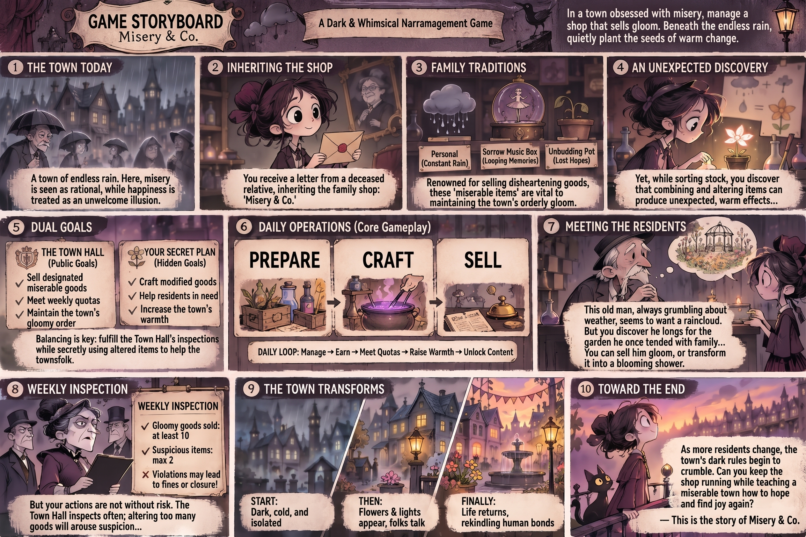
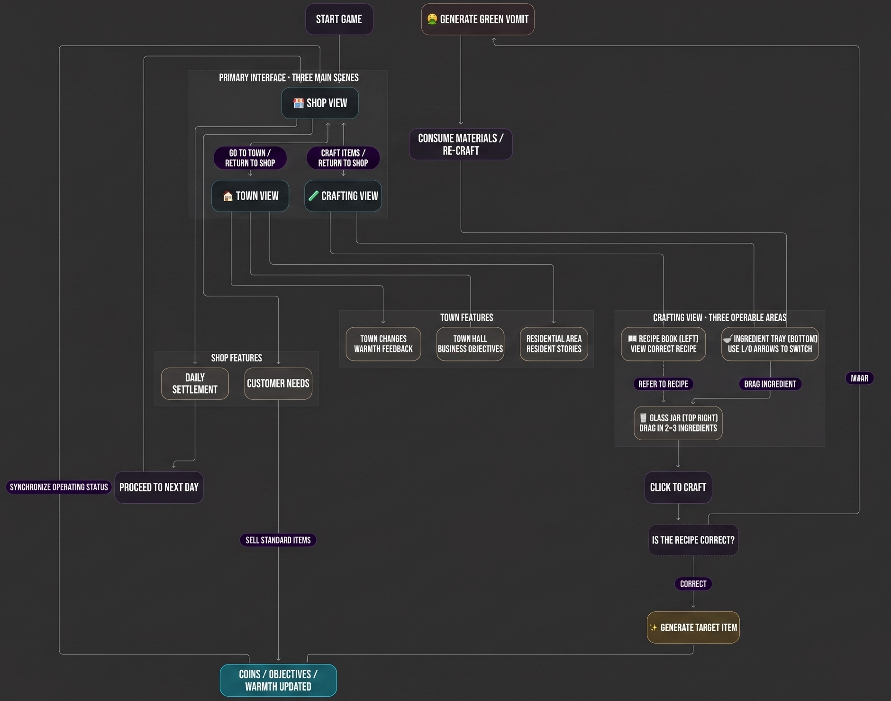

# Misery & Co.

> A Dark & Whimsical 2D Narrative Management Game  
> **Course Project:** [SD5913 Group Project](https://canvas.polyu.edu.hk/courses/4750)  
> **Repository:** [https://github.com/sd5913/Misery-Co.](https://github.com/sd5913/Misery-Co.)

---

## 1. Project Concept & Purpose

In a town of endless rain, misery is seen as rational, while happiness is treated as an unwelcome illusion. After receiving a letter from a deceased relative, the player inherits the long-standing family business—**Misery & Co.**, a shop renowned for selling disheartening goods such as *Personal Rainclouds*, *Sorrow Music Boxes*, and *Unbudding Pots* that help maintain the town's orderly gloom.

Yet, while sorting through stock, you accidentally discover that combining and altering different ingredients can produce unexpected, warm effects (such as transforming a *Personal Raincloud* into a *Blooming Shower*). Players must find a delicate balance between two conflicting objectives: **fulfilling the Town Hall's weekly gloomy sales quotas (Public Goals)** to avoid fines or shop closure, while **secretly using altered items to help the townsfolk and raise the town's warmth (Hidden Goals)**—ultimately shaking the town's dark rules and teaching a miserable town how to hope and find joy again.

### Game Storyboard


---

## 2. Target Audience

* **Core Players:** Fans of 2D indie narrative games, shop management simulations, and story-driven interactive experiences.
* **Aesthetic Appeal:** Players drawn to dark fairy tales, hand-drawn illustrations, and minimalist gothic/whimsical art styles.
* **Experience Goals:** Casual and narrative-focused players looking for an atmospheric, short-form interactive experience that explores emotional contrast and heartwarming storytelling beneath a gloomy surface.

---

## 3. Interaction & Core Gameplay

The game utilizes mouse-based **Point-and-Click** and **Drag-and-Drop** interactions, revolving around a daily management loop (`Manage → Earn → Meet Quotas → Raise Warmth → Unlock Content`) across three main scenes:

### System Workflow


### Three Primary Views & Mechanics
1. **Shop View**
   * **Customer Needs:** Listen to patrons who seemingly only want standard gloomy items, and uncover what they truly long for through their stories and dialogue.
   * **Sales & Daily Settlement:** Choose to sell standard disheartening goods to safely earn coins and meet Town Hall quotas, or take a risk by offering modified warm items to comfort residents. Conclude the day to synchronize operating status and proceed to the next business day.
2. **Crafting View (First-Person Workbench)**
   * **Recipe Book (Left):** View unlocked recipes and item modification formulas.
   * **Ingredient Tray (Bottom):** Use the left and right arrows to browse and switch between available materials.
   * **Glass Jar (Top Right):** Drag 2–3 ingredients into the glass jar and click to craft. If the recipe is correct, the target item is generated; if incorrect, it generates "Green Vomit" (a failed product), consuming the materials and requiring you to re-craft.
3. **Town View (2.5D Isometric Map)**
   * **Town Hall (Business Objectives):** Check weekly inspection requirements (minimum gloomy goods sold and maximum suspicious items allowed) and submit reports for subsidies.
   * **Residential Area & Town Changes:** Unlock resident stories and observe visual feedback across the town as its warmth increases—transforming from a dark, cold, and isolated environment into a lively street filled with flowers, warm lights, and rekindled human bonds.

---

## 4. Prerequisites, Setup & How to Run

### Live Demo
* **Playable Web Build:** `[Insert GitHub Pages / Deployment URL here]`

### Prerequisites
* A modern desktop web browser (latest version of Google Chrome, Firefox, Microsoft Edge, or Safari recommended).
* A lightweight local static server for local execution (e.g., VS Code `Live Server` extension, Node.js `http-server`, or Python `http.server`).

### Local Setup & Execution
1. **Clone the repository:**
   ```bash
   git clone [https://github.com/sd5913/Misery-Co..git](https://github.com/sd5913/Misery-Co..git)
   cd Misery-Co.

---

## 5. Team Collaboration

📊 Track weekly task status, deadlines, and deliverables via the **[Team Scrum Board](https://github.com/orgs/sd5913/projects/30/views/1)**

| Stage | Timeline | Core Deliverables |
| :--- | :--- | :--- |
| **Phase 1 (Prototyping)** | Weeks 1–2 | Finalize game concept, 10-panel storyboard, system workflow diagram, and foundational scene-switching prototype (`Shop`, `Crafting`, and `Town` views). |
| **Phase 2 (Mechanics)** | Weeks 3–4 | Implement first-person workbench drag-and-drop crafting logic, recipe verification, customer dialogue system, and daily settlement loop (`Coins` / `Quotas` / `Warmth`). |
| **Phase 3 (Polishing)** | Weeks 5–6 | Conduct user playtesting, refine UI/UX interactions, integrate 2.5D Town View visual progression, sound effects, and Town Hall weekly inspection events. |
| **Phase 4 (Delivery)** | Week 7 | Final QA debugging, balance adjustments, live web build deployment, and final documentation review. |

### Weekly Tutorial Log & Progress

| Course Week | Delivery Focus | Weekly Goals & Completed Work | Playtest Feedback & Blockers | Next Steps & Adjustments |
| :--- | :--- | :--- | :--- | :--- |
| **Nov 5, 2026** | First Working Interaction | Finalized game concept, 10-panel Game Storyboard, and core System Workflow; initialized `sd5913` repository and Team Scrum Board. | Need to balance the tension between Public Quotas and Hidden Warmth so players feel meaningful risk. | Build the foundational scene switching prototype and UI layout. |
| **Nov 12, 2026** | Core Experience Integration | *(To be updated)* | *(To be updated)* | *(To be updated)* |
| **Nov 19, 2026** | Playtest & Feedback | *(To be updated)* | *(To be updated)* | *(To be updated)* |
| **Nov 26, 2026** | Release Candidate | *(To be updated)* | *(To be updated)* | *(To be updated)* |
| **Dec 3, 2026** | Final Assessment | *(To be updated)* | *(To be updated)* | *(To be updated)* |

---

## 6. Credits, Assets & AI Usage Disclosure

In accordance with course guidelines on academic integrity and asset attribution, the tools, assets, and AI assistance used in this project are documented below:

* **Development Stack:** HTML5, CSS3, JavaScript, Git & GitHub.
* **AI-Assisted Code Generation:** Generative AI tools (ChatGPT / Gemini) were used to generate and iterate on the HTML, CSS, and JavaScript code for the web application, under the team's prompt direction, testing, and debugging.
* **Visual Art & Concept Assets:**
  * The game concept, storyboard, character designs, and UI mockups were conceived by the team and generated/stylized using AI image generation tools (ChatGPT / Gemini).
  * The System Workflow diagram was created by the team and translated with AI assistance.
